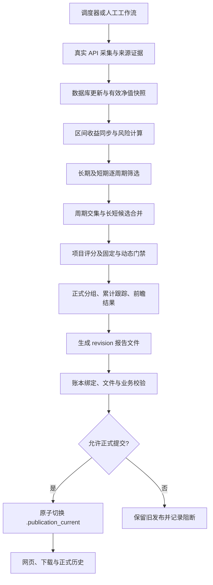
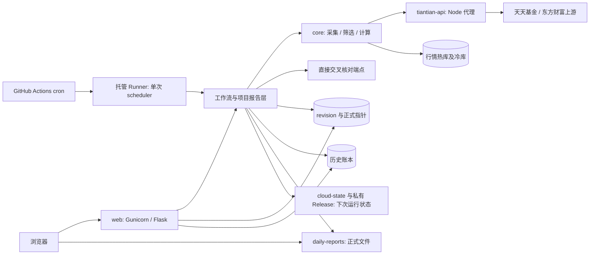

# Fund-ANA：基金采集、筛选与正式报告发布系统

Fund-ANA 将真实基金 API 采集、净值存储、风险计算、多周期筛选、项目级复核、累计跟踪和报告发布连接为一套自动化流程。后端负责计算和发布，前端展示已提交的正式结果；调度器刷新数据，并在有合格新快照时触发筛选。

本文按 **2026-11-12 核对的 1.9.794 源码**说明实现，版本入口为 [core/version.py](core/version.py)。文中数值是公式、配置或策略参数，不是实际基金数据，也不是对当前生产服务健康状态的验收结论。升级或修改配置后，应以对应版本的配置、公式契约和发布清单为准。

本仓库的 **main 分支用于源码分发**，不包含基金数据库、历史账本、用户收藏、原始 API 响应、冻结输入、备份或生产凭据。核验通过的正式报告、历史状态及运行诊断保存在独立私有仓库 `DaDaDa12138/fund-ana`，需要相应访问权限。本公开仓库 `DaDaDa12138/fund-ana-public` 只分发源码和执行工作流。首次部署仍需从真实接口建立数据，不能只启动容器就认为已经恢复正式发布。

GitHub Actions 每日执行与报告分支的详细说明见 [GitHub 日更运维文档](docs/GITHUB_ACTIONS_DAILY_REPORTS.md)。

## 阅读导航

- [1. 业务范围与正式结果](#1-业务范围与正式结果)
- [2. 底层架构与代码分工](#2-底层架构与代码分工)
- [3. API 来源与调用方式](#3-api-来源与调用方式)
- [4. 数据存储与追溯](#4-数据存储与追溯)
- [5. 完整工作流的执行顺序](#5-完整工作流的执行顺序)
- [6. 收益与风险计算](#6-收益与风险计算)
- [7. 核心多周期筛选与评分](#7-核心多周期筛选与评分)
- [8. 项目复核与动态门槛](#8-项目复核与动态门槛)
- [9. 报告生成与原子发布](#9-报告生成与原子发布)
- [10. 累计跟踪与前瞻验证](#10-累计跟踪与前瞻验证)
- [11. 历史账本与冻结复算](#11-历史账本与冻结复算)
- [12. 每日调度与保旧行为](#12-每日调度与保旧行为)
- [13. 前端页面与后端接口](#13-前端页面与后端接口)
- [14. 存储生命周期](#14-存储生命周期)
- [15. 空环境部署与首次运行](#15-空环境部署与首次运行)
- [16. 运维验证与故障定位](#16-运维验证与故障定位)
- [17. 项目修改与源码分发边界](#17-项目修改与源码分发边界)
- [18. 源码阅读索引](#18-源码阅读索引)

## 1. 业务范围与正式结果

项目围绕债券基金建立长短周期候选池，再执行项目级数据、质量、风格及发布检查，输出正式榜单和历史跟踪。



| 结果 | 含义 | 能否当作当前正式榜 |
|---|---|---|
| 核心筛选结果 | `core/` 各周期和长短合并输出 | 不能，仍需项目复核 |
| 项目候选池 | 二次门禁需要评估的正式及诊断候选 | 不能，包含未达标项 |
| 影子分析、观察池 | 研究替代规则、缺失原因或动态适配 | 不能，不自动晋升正式 |
| 生成的报告文件 | 某次运行或修订已物化的产物 | 单凭文件存在不能确认 |
| 已提交正式发布 | 被正式提交描述引用的合格 revision | 可按对应发布身份解释 |
| 旧版可发布快照 | 旧流程留下的可发布历史材料 | 保留原身份，不因导入账本升级 |

**当前正式发布的权威提交点是 `reports/.publication_current`。** `latest.json`、文件修改时间、网页缓存、日志中的“完成”以及账本里存在一条记录，均不能单独替代它。实现见 [publication.py](backend/publication.py) 与 [publication_transaction.py](backend/publication_transaction.py)。

## 2. 底层架构与代码分工

### 2.1 技术组成

| 层次 | 技术及职责 |
|---|---|
| 展示层 | 原生 HTML、JavaScript、CSS 多页面；无 React/Vue 打包链 |
| HTTP 服务 | Flask 路由及业务服务；生产通过 Gunicorn 提供访问 |
| 工作流层 | Python 编排、子进程、超时、心跳、任务状态与锁 |
| 核心计算层 | 项目自有采集器、过滤器、评分器、风险计算与周期合并 |
| 数据层 | SQLAlchemy、SQLite/WAL；净值/排名冷数据可由 SQLite、Parquet 提供 |
| 分析与导出 | pandas、NumPy、openpyxl；冷库查询使用 PyArrow/DuckDB 等组件 |
| 定时层 | GitHub Actions cron；托管 Runner 内调用 scheduler 单次任务；独立 APScheduler 为本地部署选项 |
| 上游适配层 | 固定源码版本的 Node.js 基金代理及直接 HTTP 交叉核对 |
| 部署层 | Docker Compose，应用镜像与基金代理镜像分离 |



### 2.2 目录分工

| 目录或入口 | 责任 |
|---|---|
| [backend/](backend/) | Flask API、工作流、项目复核、正式发布、跟踪、历史账本、调度和存储管理 |
| [core/](core/) | 项目自有采集和筛选引擎；不是外部参考代码 |
| [frontend/](frontend/) | 总览、Tracker、推荐、收藏、报告、历史及运维页面 |
| [scripts/](scripts/) | 工作流、调度、账本、存储、审计和隔离测试入口 |
| [deploy/](deploy/) | 容器入口及固定上游版本的基金代理 |
| [tests/](tests/) | 回归和契约测试；真实业务样本不随源码分发 |
| [config/project.example.yaml](config/project.example.yaml) | 项目模板；复制为本地 `config/project.yaml` 使用 |
| [core/config/config.yaml.template](core/config/config.yaml.template) | 核心模板；复制后配置本地密钥等内容 |
| `backend/data/` | 行情主库、账本、收藏和运行状态，不入源码仓库 |
| `reports/` | 中间产物、revision、清单、跟踪和冻结输入，不入源码仓库 |
| `logs/`、`core/logs/` | 运行日志，不入源码仓库 |

项目配置由 [backend/config.py](backend/config.py) 加载；核心兼容桥在 [project_runtime_config.py](core/utils/project_runtime_config.py) 和 [config_manager.py](core/utils/config_manager.py)。只修改一份旧核心配置，不代表覆盖项目所有规则。

### 2.3 三个容器如何合作

[docker-compose.yml](docker-compose.yml) 定义：

1. **tiantian-api**：内部端口 3000，为采集器提供本地适配入口。
2. **web**：Gunicorn/Flask，默认对外端口 8090；通过环境变量禁用内嵌调度器。
3. **scheduler**：与 web 使用同一应用镜像，属于显式启用的 `local-scheduler` profile，默认不启动。当前生产定时任务由 GitHub 托管运行。

web 与 scheduler 共享数据库、报告和状态目录。scheduler 另有 `/mnt` 共同挂载，用于同盘 rename 和文件使用状态审计；迁移部署时须检查宿主路径。主应用与代理镜像分别管理，标签数字不要求相同。

## 3. API 来源与调用方式

### 3.1 主要采集：本地基金代理

项目请求 `apis.tiantian_base_url`，Compose 默认 `http://tiantian-api:3000`。采集器访问本地 HTTP GET 路由，代理再按适配器完成上游请求；**本地 GET 不意味着上游协议也一定是 GET**。

协议入口见 [endpoints.py](core/api/endpoints.py)、[api_config.py](core/config/api_config.py) 及 [deploy/tiantian-api/](deploy/tiantian-api/)。代理保留上游 LICENSE、`upstream.json` 和文件 SHA，维护时需保持来源可核验。

| 本地路由 | 用途 | 参数及约束 |
|---|---|---|
| `/fundMNRank` | 目录、类型、排行、区间收益与最新净值相关字段 | `FundType`、`pageIndex`、`pageSize`；页码从 1 开始，页大小 1–30 |
| `/fundMNDetailInformation` | 详情、成立日、规模、费率和持有期相关信息 | `FCODE` |
| `/fundMNStopWatch` | 详情为空时补充轻量类型元数据 | 不能替代完整详情或持有期事实 |
| `/fundMNHisNetList` | 历史单位净值、累计净值、日涨幅 | `FCODE`、`pageIndex`、**`pagesize` 全小写** |
| `/fundMNPeriodIncrease` | 区间收益及基准日期 | 代码及适配器要求的公共参数 |
| `/fundVPageDiagram` | 净值图序列 | 不能无条件替代完整日历史 |
| `/fundMNMangerList`、`/fundMSNMangerInfo` 等 | 经理关系、详情与履历 | 基金或经理标识 |
| `/fundCompanyBaseList`、`/companyApi2` | 公司资料 | 分页或公司标识 |
| `/fundGradeDetail`、`/fundSearch` 等 | 评级和检索等补充信息 | 见相应适配方法 |

上游 `FundType` 与项目内部 `type_code` 有映射，不应直接混用。设备、平台、版本等公共请求字段由适配器维护。

代理 `/healthz`、`/health` 仅证明本地能响应；`upstream_checked=false` 时不能证明上游业务可用。网络失败、超时、并发容量耗尽分别有失败响应。HTTP 成功、空 `Datas`、成功解析和实际写库是不同事件。

### 3.2 直接交叉核对端点

正式校验配置使用 `eastmoney_cross_endpoint`，入口为 [fund_cross_validation.py](backend/fund_cross_validation.py) 和 [fund_snapshot.py](backend/fund_snapshot.py)。

| 来源 | 方法与地址 | 请求及作用 |
|---|---|---|
| 天天基金批量快照 | `POST https://fundcomapi.tiantianfunds.com/mm/newCore/FundValuationLast` | 表单 `FCODES` 代码列表、`FIELDS` 字段列表；读取净值、收益、日期与可选估值 |
| 同协议备用域名 | `POST https://fundcomapi.eastmoney.com/mm/newCore/FundValuationLast` | 相同端点协议的域名备用 |
| 东方财富基金信息 | `GET https://fundmobapi.eastmoney.com/FundMNewApi/FundMNFInfo` | `Fcodes`、`plat=Android`、`deviceid=fund-ana`、`product=EFund`、`Version=6.6.8`、`appType=ttjj` 及分页参数 |
| 交易状态补充 | `GET https://fund.eastmoney.com/Data/Fund_JJJZ_Data.aspx` | 补充申购/赎回状态，不代替收益或日历史 |

`FundValuationLast` 的 `NAV`、`ACCNAV`、`NAVCHGRT`、`PDATE`、`SYL_*` 是净值和收益信息；`GSZ`、`GSZZL`、`GZTIME` 才涉及盘中估值。净值可用不代表估值字段也可用。

天天基金与东方财富同属一个数据体系。这些请求能核对端点与数据库的一致性，**不能宣称两个独立供应商已证明数据绝对正确**；备用域名也不是独立数据源。

### 3.3 AutoStock、蛋卷和实时估值

- **AutoStock**：兼容代码保留，模板中 `enabled: false`。不是当前正式发布必须通过的在线来源，不应因停用端点无响应继续阻断发布。
- **蛋卷**：`https://danjuanapp.com/djapi/fund` 为可选证据源，默认停用；不能写成已完成覆盖与时效验收的正式依赖。
- **盘中估值**：Tracker 的可选展示，不是每日净值报告的必需输入。缺失时明确展示缺失，不伪造数值。

[valuation_contract.py](backend/valuation_contract.py) 检查 `GSZ`、`GSZZL`、`NAV`、`PDATE`、`GZTIME`、抓取时间及估值基准一致性。模板新鲜度为 1,800 秒，净值基准最大年龄 10 天，实际以配置为准。过期估值、未提供估值、真实零涨幅分别处理。

### 3.4 缺失语义是数据契约的一部分

[value_contract.py](backend/value_contract.py) 等模块区分未请求、字段不存在、供应商空值、解析失败及已观测值；快照和估值契约再表达真实零值、过期等状态。

近三月收益为空不是 0%；有名称不等于有净值；返回旧日期不等于今天已更新。采集验收同时看请求、响应、有效字段、拒绝原因和写库数，不能只看 HTTP 状态。

## 4. 数据存储与追溯

### 4.1 行情库主要表

主要模型见 [core/database/models.py](core/database/models.py)，默认热库为 `backend/data/bond_funds.db`。

| 表或表组 | 内容 |
|---|---|
| `funds` | 代码、名称、类型、成立及持有期等基础信息 |
| `fund_nav_history` | 日期、单位净值、累计净值、日涨幅 |
| `fund_returns` | 区间收益、最新净值、收益基准日期、采集时间及来源摘要 |
| `fund_scale`、`fund_risk_metrics` | 规模与风险指标 |
| `fund_managers`、`fund_companies`、`fund_grades` | 经理、公司与评级 |
| `fund_annual_returns`、`fund_rank_history` | 年度收益、历史排名 |
| `collection_log`、`task_status`、`task_history` | 采集和任务记录 |
| `screening_runs`、`screening_decisions` | 筛选运行、阶段决策与原因 |
| `screening_picks`、`screening_pick_metric_snapshots` | 入选记录及当时指标快照 |
| 原因摘要、最新活动、存储统计表 | 筛选审计及存储治理辅助 |

基金代码按字符串保存，保留前导零。行情更新不仅追加新日期，也可能修订同日收益或补齐区间收益，影响后续计算。

### 4.2 热冷数据共同查询

较早净值或排名可在冷 SQLite、Parquet 分片中，由 [nav_history_queries.py](core/database/nav_history_queries.py)、[rank_history_queries.py](core/database/rank_history_queries.py) 等合并查询，并检查绑定身份。

`archive` 目录不代表无用。仍被查询绑定的分片属于在线计算依赖；只保留热库可能造成长期覆盖不足并改变筛选。

### 4.3 时间与证据链

业务运行日期、数据/NAV 日期、抓取时间、正式发布时间分别记录，节假日和上游延迟时可能不同。

[source_evidence.py](core/collectors/source_evidence.py) 记录来源调用及采集证据；冻结输入、筛选决策、报告 JSON 和 manifest 绑定本次输入、计算和发布：

```text
来源请求、响应状态及可保留的来源证据
  → 字段、日期、缺失状态及写库结果
  → 本轮实际计算输入、配置和公式版本
  → 各阶段决策、原因码及指标快照
  → revision 报告及文件
  → manifest、history_binding 和正式提交描述
```

这证明计算链的对应关系，不保证供应商原始数据绝对正确。原响应保留范围和捕获完整性，以具体运行证据为准。

## 5. 完整工作流的执行顺序

### 5.1 入口与编排

人工入口为 [run_bond_workflow.py](scripts/run_bond_workflow.py)：

```text
CLI / 调度子任务 / POST /api/run
  → backend.workflow.WorkflowManager
  → backend.standalone_runner.run_project_pipeline
  → backend.core_runner 构造、执行核心命令
  → core 采集、计算、daily-screening-master
  → backend.report_builder 构建项目报告
  → 发布检查与 publication_transaction 提交
```

[workflow.py](backend/workflow.py) 管理运行身份、状态、锁和日志；[core_runner.py](backend/core_runner.py) 管理命令及顺序。受控子进程有阶段超时、部分阶段的空闲超时、心跳和陈旧状态恢复。不能并发启动争用主库和发布目录的正式流程。

### 5.2 采集、维护与筛选阶段

`full`、`daily`、`weekly` 采集范围不同，不是每次都全量抓取所有资料。

| 顺序 | 阶段 | 处理及输出 |
|---|---|---|
| 1 | 初始化 | 主库缺失时 `init-db`，检查路径、配置和核心入口 |
| 2 | 基金目录 | 通常 `collect-funds -t bond`，刷新待处理集合 |
| 3 | 详情/规模 | full、weekly 可刷新完整详情；daily 更侧重 `--scale-missing-only` |
| 4 | 经理 | 按 profile、缺失、陈旧和重试窗口刷新关系及详情 |
| 5 | 日净值 | full、daily 运行 `collect-nav`；已有历史优先增量，长期缺口另行补齐 |
| 6 | 区间收益 | `collect-period-returns` 安排在风险计算或筛选前，保存基准日期 |
| 7 | 风险刷新 | 对新增、变更和需自愈目标计算风险及公式状态 |
| 8 | 持有期补正 | 必要时运行 `supplement_bond_holding_period.py` |
| 9 | 公司 | 按 full、weekly 等条件刷新，避免其失败先阻止必要风险维护 |
| 10 | 核心筛选 | `daily-screening-master` 生成各周期和合并结果 |
| 11 | 项目报告 | 评分、二次门禁、分组、跟踪、前瞻与物化 |
| 12 | 正式提交 | 业务、来源、文件校验及账本绑定合格后切换指针 |

部分详情、经理、区间收益失败可以先保留证据并继续必要维护；筛选前仍检查阻断。继续执行维护不等于忽略失败允许发布。

风险刷新通常面向变更目标及定向自愈，显式强制可扩大重算。即使净值新增 0 条，也可能有同日收益修订、缺失周期指标，不能据此跳过全部检查。

### 5.3 参数与正式边界

| 参数 | 行为 |
|---|---|
| 不带跳过参数 | 按配置真实采集、计算、筛选，尝试正式提交 |
| `--collection-profile daily` | 日常采集 profile，仍受全部正式门禁约束 |
| `--skip-collection` | 用已有库数据继续，仍检查时效、输入和发布条件 |
| `--reuse-existing-outputs` | 用已有核心产物重建，标为诊断用途 |
| `--skip-screening` | 无新的核心筛选，属于诊断路径 |
| `--skip-risk-calculation` | 跳过风险重算，属于诊断路径 |
| `--force-calculate-risk` | 显式要求重算，不豁免数据门禁 |

诊断路径由发布控制标记 `diagnostic_only`，不能因为生成新文件就宣称新正式发布。核心入口缺失必须报错，不能拿历史结果冒充本轮计算。

## 6. 收益与风险计算

### 6.1 先检查序列质量

计算前检查日期、排序、重复、点数、覆盖、间隔和来源。API `daily_growth` 为百分比，进入复利前转为小数。

优先用实际日收益构造总回报。部分风险路径仍有累计净值或单位净值降级，但必须保留来源，**不能将降级输入标为已验证的分红再投资总回报**。前瞻验证有更严格契约。

实现见 [risk_analyzer.py](core/analyzers/risk_analyzer.py)、[risk_calculator.py](core/bond_fund_screening/core/risk_calculator.py)、[nav_observation_quality.py](core/bond_fund_screening/core/nav_observation_quality.py) 与 [nav_window.py](core/bond_fund_screening/core/nav_window.py)。

### 6.2 基础公式

令有效日收益为小数 `rₜ`，实际自然日跨度为 `D`，年化观测频率为 `N`：

```text
累计收益 R = ∏(1 + rₜ) - 1
本地年化收益 A = expm1(log1p(R) × 365.25 / D)
年化波动率 σ = sample_std(rₜ, ddof=1) × √N
财富曲线 W₀ = 1，Wₜ = Wₜ₋₁ × (1 + rₜ)
回撤 = 1 - Wₜ / 历史运行峰值
最大回撤 MDD = 回撤序列最大值
```

有效性、跨度和可计算性检查先于公式。风险引擎 `N` 按观测间隔密度估计，限制在 1 与配置上限之间；不连续数据不能无条件当作完整 252 日样本。年化收益用自然时间，不用观测条数替代。

相关回撤持续期按连续水下**观测点数**计算，不直接等于自然日。收益百分比、小数和规模单位显式转换，例如小数 `0.02` 是 2%，不是 0.02%。

### 6.3 有版本的策略风险指标

共同核心为 [standard_risk_metrics.py](core/bond_fund_screening/core/standard_risk_metrics.py)，说明为 [metric_formula_contract.py](core/bond_fund_screening/core/metric_formula_contract.py)。当前契约 `strategy-risk-2026-10-28.3` 标记为 `project_strategy_indicator`，不能省略口径后宣称完全等同所有标准金融定义。

| 指标 | 主要定义 |
|---|---|
| 项目 Sharpe | `(A - rf) / σ`；分子是年化收益，不是同频率平均超额收益 |
| 项目 Sortino | `(A - MAR) / [sqrt(mean(min(rₜ - MAR/N, 0)²)) × sqrt(N)]` |
| 数据库 Calmar | `A / MDD`，零回撤保留 NULL |
| 筛选策略 Calmar | `clip((A - rf) / max(abs(MDD), style_floor), -20, 20)` |
| 对照 Calmar | 另存 `standard_calmar_ratio` 等，不能与策略变体混名 |

契约记录 `rf`、`MAR`、`N`、引擎、回报来源、验证状态和缺失政策。Sharpe、Sortino 原值与限幅值分别保留：Sharpe 上限 5，Sortino 限于 `[-10, 10]`。零分母或不可计算时保留 NULL 与 `undefined_metric_reasons`，不造极小分母制造高分。

筛选中部分“月度”统计使用 **20 个观测点的桶**，不是自然月收益；项目也有自然月辅助逻辑，应按字段调用路径区分。

### 6.4 成立以来收益分开命名

[lifetime_returns.py](backend/lifetime_returns.py) 区分：

- **平台成立以来收益年化(%)**：使用 `SYL_LN`、成立日与收益基准日，满足至少一年等条件后计算 `100 × [(1 + SYL_LN/100)^(365.25/elapsed_days) - 1]`。
- **累计净值比年化(%)**：按本地累计净值首尾比及实际跨度计算，使用独立标签及来源。

两者可能不同，不能互相覆盖。累计净值比不能直接等同平台分红口径，单位净值价格变化也不能代替总回报。

## 7. 核心多周期筛选与评分

### 7.1 四步串行主任务

[daily_screening_master.py](core/bond_fund_screening/tasks/daily_screening_master.py) 顺序执行：

1. 长期：1、2、3、4、5 年各周期筛选并合并。
2. 短期：1 周、1 月、3 月、6 月各周期筛选并合并。
3. 最终合并：构建核心主名单和观察候选。
4. 核心累计跟踪：登记核心日结果。

配置周期须成功并产生本轮文件，不能静默删减或拿旧文件补齐。`top_n=None` 表示单周期保留全部达标项，不是任意选取固定只数。

### 7.2 单周期逐层过滤

入口为 [base_analyzer.py](core/bond_fund_screening/analyzers/base_analyzer.py) 的 `run_pipeline`，规则见 [filtering_engine.py](core/bond_fund_screening/core/filtering_engine.py)。

| 阶段 | 检查 |
|---|---|
| Layer 1 | 基础资格、实际周期收益及必要字段 |
| Layer 2 | 持有期政策 |
| Layer 3 | 成立时间与成熟度 |
| Layer 4 | 周期覆盖与可观测性；短期债基还涉及一年可观察条件 |
| Layer 5 | 分周期规模 |
| Layer 5.5 | 费率 |
| Layer 6A | 可计算性：日期、点数、覆盖、间隔和样本质量 |
| Layer 6B | 同类相对风险与持续性 |
| Layer 6C | 绝对收益、回撤及风险质量控制 |
| 评分与 Layer 10 | 双评分后稳定排序，按策略输出 |

原 Layer 7、8 的职责已并入 Layer 6，Layer 9 在当前主路径跳过，不能描述成“十层全部独立启用”。

[bond_profile.py](core/bond_fund_screening/profiles/bond_profile.py) 配置普通债券、定开等 profile。普通债基核心基础成熟度为 365 天、基础规模为 1 亿元，长期周期要求可提高；这些不能代替项目正式门禁。

逐阶段决策、原因码、配置和指标快照落库。分析榜单为空，应先查看淘汰链，而不是从最终文件倒猜市场表现。

### 7.3 持有期解析

实现见 [holding_period_parser.py](core/utils/holding_period_parser.py)、[holding_period_policy.py](core/utils/holding_period_policy.py)、[supplement_bond_holding_period.py](scripts/supplement_bond_holding_period.py)。

1. 利用结构化周期字段，结合短名、全名、策略文本及同母基金份额证据。
2. 识别数字、中文数字及天/周/月/年；策略换算月按 30 天、年按 365 天。
3. 结构化和名称出现不同具体期限时，采用更长具体期限。
4. 有可用名称且没有限制证据、没有可量化期限时，按普通基金政策评估；数据库 `holding_days` 仍可为 NULL，不伪造 API 返回了 0。
5. 已知有持有/封闭/定开等限制但期限未解析时保留未解决状态；无可用名称和事实时保留未知，不一律放行。
6. 历史 `999` 可能是泛化占位，要结合来源和关键词识别，不直接当作实测天数。
7. **项目正式榜排除已知持有期超过 90 天的基金**，核心兼容 profile 不得绕过最终约束。

名称推断是明确的策略假设，不等于核验合同。流动性评分复用解析政策，规模、成立日等缺失也保留相应状态，不一律给最优分。

### 7.4 核心双评分与四维评分

[scoring_engine.py](core/bond_fund_screening/core/scoring_engine.py) 默认使用 90% 相对排名、10% 绝对基准的混合归一化。下表为债基标准配置；有效权重优先由传入的 profile 决定，兼容路径还支持 aggressive、balanced 等配置。

| 核心评分 | 指标与权重 |
|---|---|
| 短期 | 近 1 月收益 20%、近 3 月收益 20%、Sharpe 30%、Sortino 15%、波动率 15%（负向） |
| 长期 | 年化收益 25%、持续性 23%、最大回撤 15%、回撤持续期 5%、Sortino 10%、Calmar 10%、费率 12% |
| 综合 | `0.40 × 核心短期分 + 0.60 × 核心长期分` |

短周期还有结构性排除：不超过 180 天的窗口不采用 Sortino 特征，不超过 30 天还排除 Sharpe 和 Calmar 特征，避免短样本比率失真。因此，表中配置权重不能直接解释为每个短周期都完整使用了这些指标；实际参与项与分值按当前特征构建路径核对，不能自行假定缺项按原权重重归一化。

[enhanced_scoring_engine.py](core/bond_fund_screening/core/enhanced_scoring_engine.py) 另有收益、风险、稳定、流动性四维分；balanced 权重为 25%、35%、25%、15%，其他偏好另配。**四维增强评分不等于增强债弹性榜。**

### 7.5 周期交集与长短合并

[multi_period_merger.py](core/bond_fund_screening/analyzers/multi_period_merger.py) 按同一长/短系列的周期覆盖建立交集；至少两个周期出现即可形成相应交集层级，不要求所有周期全交集。

当前交集质量条件包括平均综合分、平均 Sharpe、最差周期收益、分数标准差，对应基线为 25、0、-3%、15。稳定排序由周期覆盖 40%、平均综合分 35%、稳定分 25% 组成；缺失按契约处理。

[daily_final_screening.py](core/bond_fund_screening/tasks/daily_final_screening.py) 与 [final_screening_candidate_helpers.py](core/bond_fund_screening/tasks/final_screening_candidate_helpers.py) 区分硬交集、软交集和单边观察。先按母基金对齐，再挑份额，避免 A/C 导致伪单边；对侧分数可读 `screening_picks`，不以缺失补 0。

长短候选合并基础权重为短期 0.35、长期 0.50；债基 override 的硬交集 bonus 为 4、软交集为 0。这与核心 40/60、项目正式 45/55 **不是同一层评分**。核心 `all_eligible` 保留达标项，项目层再复核并按条件收敛数量。

## 8. 项目复核与动态门槛

### 8.1 候选宇宙与正式评分

[report_builder.py](backend/report_builder.py) 读取本轮产物及数据库，统一代码、份额、风格、字段、评分和来源。核心入选不直接等于正式入选。未知申购、费率、规模日期等不得默认可申购、免费或新鲜。

项目按同风格百分位构建评分，契约为 `formal-score-2026-10-28.1`：

```text
正式投资评分 = 45% × 项目近期得分 + 55% × 项目长期得分
```

| 项目近期组件 | 权重 | 项目长期组件 | 权重 |
|---|---:|---|---:|
| 近 6 月收益 | 16% | 年化收益 | 22% |
| 近 1 年收益 | 14% | 近 1 年收益 | 10% |
| 年化收益 | 14% | 近 3 年收益 | 6% |
| Sharpe | 14% | Sharpe | 10% |
| Sortino | 12% | Sortino | 10% |
| 最大回撤（负向） | 10% | Calmar | 18% |
| 波动率（负向） | 10% | 最大回撤（负向） | 8% |
| 正收益比例 | 10% | 正收益比例 | 6% |
| — | — | 总费率（负向） | 5% |
| — | — | 规模 | 5% |

必需指标缺失导致组件或总分缺失。近 3 年收益等允许的可选项缺失，仅按实际可用权重重归一化，不复制另一组件制造完整分数。字段、单位和有效性见 `build_formal_score_contract` 等实现。

### 8.2 二次发布流水线

[publish_pipeline.py](backend/publish_pipeline.py) 的 `run_publish_pipeline` 依次：

1. 附加决策列，评估固定质量条件。
2. 从基础门禁合格样本生成分风格动态阈值。
3. 应用动态质量条件和增强风格补充门禁。
4. 应用发布后置过滤，取可正式推荐候选。
5. 接入历史跟踪特征，执行最终选择。
6. 复核校验状态及兼容硬拦截，形成正式分组。
7. 对齐增量安全观察；未选中或不合格项转为诊断。

输出保留 candidate、publish track、official、internal watch 和阈值等视图，不可将其数量都叫“正式基金数”。

### 8.3 固定规则与市场动态适配

实现见 [project_quality_thresholds.py](backend/project_quality_thresholds.py)、[project_publish_decisions.py](backend/project_publish_decisions.py)。

固定检查涵盖申购、净值/区间收益日期、风险完整性、持有期、费率、规模日期、经理覆盖、评分、来源核对和质量信心。

动态门槛按风格估计：最小样本量为 15，5%–95% winsorize 用于**阈值估计，不改业务原值**。评分、收益、风险、费率等使用各自分位数，并与风格 floor/cap 合成。样本不足回到固定风格规则。

基础字典中可见评分 58/56/58、年化 2%、规模 2 亿元等基线，但风格及增强补充规则仍会参与，不能当作全市场统一最终门槛。一级、二级、转债增强另有收益、经理、回撤、Calmar、费率等补充要求。

动态适配不会因为名单为空而关闭数据缺失、持有期或绝对风险安全线，不能用“必须有基金入榜”倒推门槛。

### 8.4 正式分组与数量收敛

[project_formal_groups.py](backend/project_formal_groups.py) 输出：

- **纯债稳健榜**：符合稳健风格及正式条件的结果。
- **增强债弹性榜**：一级/二级/转债增强等风格，或规则识别的权益、转债增强暴露。

“增强”不是按高利率、高收益名字分类。弹性榜为零可能来自历史、风险、经理、规模、费率或数据状态，不能直接推出市场上所有增强基金都差。某分组允许为空，整个正式结果为空则阻断发布。

配置 `final_selection_target_max=320`、分组比例 `0.25`；超过目标且历史特征条件具备时，结合稳定性、信心与新基金评分等收敛。只从已合格集合保留，不为凑数量补入不合格基金；排序有稳定的代码 tie-break。

## 9. 报告生成与原子发布

### 9.1 revision 内的产物

报告按 `run_id`、`revision` 组织，典型目录 `reports/runs/<run_id>/revisions/<revision>/`，具体文件名由代码生成。

| 产物类别 | 用途 |
|---|---|
| 报告 JSON | 结果、计数、日期、来源、决策、门禁及文件引用 |
| 正式 Excel/CSV | 正式榜展示与下载 |
| Markdown | 运行、分组及解释摘要 |
| 项目累计跟踪 | 正式历史成员关系及统计 |
| 前瞻材料 | 截至本期可观察的结果与成熟状态 |
| 候选/诊断材料 | 淘汰原因和影子分析，不是正式名单 |
| `history_binding.json` | 本期账本身份与摘要 |
| manifest、代际描述 | 文件 SHA、发布身份与提交证据 |

冻结输入用于复算，不应把全量累计历史重复嵌入每份日报。

### 9.2 发布检查

[publication_checks.py](backend/publication_checks.py)、[publication_dependencies.py](backend/publication_dependencies.py) 等检查日期、输入 lineage、来源、名单与计数、分组、CSV/Excel/JSON/Tracker 一致性、字段和风险契约、路径及 SHA。

文件刚生成不代表数据新鲜；正式产物须属于同一份已核验结果，不能混用新旧运行。

### 9.3 唯一提交点

`commit_report_revision` 的顺序：

1. 获取发布锁，验证 revision 协议、报告内容、业务门禁及依赖身份。
2. 确认声明产物在本 revision 内冻结。
3. 非 legacy 模式写入账本并生成 `history_binding.json`。
4. 校验并持久化文件与 manifest。
5. 写下一代发布状态，`generation` 递增，同步目录。
6. 原子替换 `.publication_current`，正式提交。
7. 修复 latest、Tracker 等派生别名与索引。

**切换前失败保旧；切换后完整新代际已提交，派生索引可恢复。** 账本准备记录本身不能使历史正式可见，需与已提交身份对应。

发布后年度收益影子审计和冻结基线复算有独立绑定，不能描述成所有后续审计都已在切换前完成。

## 10. 累计跟踪与前瞻验证

### 10.1 两套历史口径

| 跟踪 | 来源与规则 | 实现 |
|---|---|---|
| 核心累计 | 核心日结果，按原业务日替换与重复处理规则 | [daily_accumulation_tracker.py](core/bond_fund_screening/tasks/daily_accumulation_tracker.py)、[accumulation_tracker.py](core/bond_fund_screening/utils/accumulation_tracker.py) |
| 项目正式累计 | 按正式历史有效版本处理，优先按 NAV 日期去重 | [project_tracker.py](backend/project_tracker.py) |

正式跟踪计算次数、频率、首次/末次、连续在榜、缺席、退出及回归。同日修订或同净值快照不重复累计；无 NAV 日期时使用对应签名规则。网页“最终优质基金累积跟踪”属于项目正式体系，不能拿核心中间跟踪替代。

### 10.2 前瞻总回报

[forward_validation.py](backend/forward_validation.py) 选历史快照，考察发布后 30、90、180、365 自然日窗口，当前最多 24 个快照。

1. 固定当时名单及项目二次门禁候选池，不能用今天存续名单替代。
2. 取发布后真实 API 日涨幅，基准行日涨幅不重复计入，初始财富为 1。
3. 复利计算总回报及财富曲线最大回撤。
4. 波动率用样本标准差乘 `sqrt(252)`，百分比展示再乘 100。
5. 检查窗口成熟、起止延迟、内部间隔：起点允许延迟 7 天、终点 10 天；内部大于 10 天的缺口不能 ready。
6. 区分尚未成熟、不完整、缺失和可验证状态。

单位净值价格变化另存 `unit_nav_price_change_pct`，不用于补齐缺失总回报，否则分红除息会被误判亏损与回撤。

比较池是历史**项目二次门禁候选池**，不是全市场无幸存者偏差样本。历史导出保留截至当时的前瞻结果，今天重评不能覆盖原记录；影子分析不等于未来收益已实现。

## 11. 历史账本与冻结复算

### 11.1 独立结构化账本

默认 `backend/data/report_history.sqlite`，与行情主库、生命周期 catalog 分开。实现见 [report_history.py](backend/report_history.py)、[report_history_store.py](core/utils/report_history_store.py)。

账本保存 run/revision、日期、发布语义、完整成员和指标、顺序、来源 SHA、公式/契约及累计/前瞻视图。schema 当前为 1，frame 契约 `report-history-frame-v1`；内容按摘要复用并压缩，成员身份可索引，不为每天复制全库。

编码保持 NULL/NA/NaT、真实零值、日期、代码、精度和行顺序。导入幂等，源缺失或冲突标为阻断，不跳过后声称完整。

### 11.2 读取模式

| 模式 | 行为 |
|---|---|
| `legacy` | 旧文件读取，用于迁移前或空环境的受控引导 |
| `shadow` | 账本与旧来源对照，定位语义差异 |
| `ledger` | 账本读取；缺失或不完整明确失败，不以空历史代替 |

模板为 `read_mode: ledger`，不代表空环境已经有有效账本。新来源导入、验证仍可能读原件，不能断言所有旧文件依赖都消失。

当前正式文件完整时，历史故障不应使其一并失效；需要历史的新计算则暂停，不能把错误当作无历史成员。

### 11.3 冻结与按需导出

新捕获保存实际读取记录、身份、契约及摘要，例如 `history_read_inputs.json.gz` 与相应对象，不能只留可变 SQLite 路径或整库哈希。旧捕获按旧契约读取，不回写成新证据。

父采集和子工作流可能跨日期引用，归档必须保持完整 lineage。历史查询按登记的有效 revision 选择，不按目录名或 mtime 猜测。

重新生成文件保留原发布身份、数据日期和历史数值，标记重新生成时间；不承诺与旧 Excel 字节和排版一致，也不在历史目录长期增加一份导出缓存。

## 12. 每日调度与保旧行为

以下调度器配置用于独立本机部署；GitHub 托管模式由 12.1 的云端 cron 驱动，关闭后台常驻定时器。

入口 [run_scheduler.py](scripts/run_scheduler.py)、[backend/scheduler.py](backend/scheduler.py)，时区 `Asia/Shanghai`，独立进程防止 web worker 重复注册。

| 任务 | 模板时间/频率 | 作用 |
|---|---|---|
| 日常刷新 | 每日 07:30 | 采集维护、快照判断与必要子工作流 |
| 午后刷新 | 每日 13:45 | 再查有效净值及修订，不以估值代替净值 |
| 快照 watchdog | 每 15 分钟 | 待推进快照、失败重试、忙时延期 |
| 周维护 | 周日 03:00 | 长历史、一致性和存储等维护 |
| 存储生命周期 | 每日 02:15 | 有界归档/清理，保护条件不满足延期 |
| 存储观测 | 每 6 小时 | 容量及增长统计，不等于删除 |

启用项、冷却和目标以配置为准。父任务先采集，再由 [effective_nav.py](backend/effective_nav.py) 识别快照，默认覆盖 90%，处理工作日和未来异常日期。

同日签名变化也可能需要重筛，不只看日期；周末、节假日或无新快照时正确保旧，不必制造重复“新报告”。

| 状态 | 处理 |
|---|---|
| 无新有效快照 | 正常保旧并解释无推进 |
| 数据未就绪或覆盖不足 | 阻断保旧，不伪造新日期 |
| 工作流/发布锁忙 | 延期，不抢占并发 |
| 上游/计算失败 | 记录阶段与失败，保旧并按策略重试 |
| 子任务合格且正式 head 推进 | 才能确认正式发布成功 |

验收须联合父子 lineage、退出状态、心跳、数据日期和正式 head。仅有进程存活或“已完成”日志不充分。

### 12.1 GitHub Actions 日更与报告保存

[浏览每日正式报告](https://github.com/DaDaDa12138/fund-ana/tree/daily-reports) · [查看 Actions 执行状态](https://github.com/DaDaDa12138/fund-ana-public/actions/workflows/daily-reports.yml)

只取源码、不下载报告分支时，可使用 `git clone --single-branch --branch main --depth 1 https://github.com/DaDaDa12138/fund-ana-public.git`。

[daily-reports.yml](.github/workflows/daily-reports.yml) 每天上海时间 **07:47**（GitHub使用UTC cron `47 23 * * *`换算）在 GitHub 托管 `ubuntu-24.04` Runner 上执行。云端恢复必要历史状态，启动独立 API 代理，直接运行真实采集、计算、筛选、冻结复算及正式发布；后续运行不调用本机或自托管 Runner。**08:17、09:17、10:47、12:17** 为有限补偿：只有当天07:47之后的完整采集、状态持久化及报告同步收据（含v1/v2限定警告证明）通过核验才跳过昂贵恢复，否则继续真实任务；并发保护不取消正在执行的任务。周日 **03:17** 数据维护对应UTC周六`17 19 * * 6`，10:47对应UTC`47 2 * * *`，其余补偿对应UTC`17 0,1,4 * * *`。业务日期、收据和界面仍为上海时区；运行环境的`TZ`不决定GitHub服务端cron时区。GitHub定时事件可能在创建运行之前延迟或丢失，补偿不能保证准点。Action摘要展示最近匹配计划、实际创建时间及本次动作；手动`operation=schedule_check`仅检查配置和收据，不采集或发布。

独立私有仓库 `DaDaDa12138/fund-ana` 的 `cloud-state` 分支保存完整性索引，私有 Release 保存分块压缩运行对象。正式报告仍在该私有仓库的 `daily-reports` 分支。数据库不进入公开源码历史；收藏和生产凭据不上传。运行对象按摘要复用，不能依赖会过期的 Actions 缓存保存唯一生产状态。公开执行仓库不能作为状态或报告写入目标。

每次运行先提交下一版云端状态，再把 SHA 核验通过的正式报告保存到 `daily-reports`：

```text
daily-reports 分支
├── README.md / latest.json
├── views/<run>/<revision>.md  # GitHub阅读版，原报告不改写
├── reports/<正式提交日期>/<run>/<revision>/
│   ├── formal.xlsx / formal.csv / report.md / tracker.xlsx
│   ├── forward-validation.*
│   ├── source-manifest.json
│   └── bundle.json
└── checks/<检查日期>/<GitHub运行ID>-<尝试次数>.json
```

同一修订不重复保存，不强制推送。净值未推进保持原报告日期；原始采集 degraded 和告警始终保留。仅对有数据库拒绝证明、正式CSV排除、零阻断和新正式提交/同快照完成证明的限定异常，自动化可为 `published_with_warnings`，Action成功并显示warning；其他降级、发布受阻或状态保存失败仍失败。同步旧正式报告不代表新采集成功。手动 `daily_refresh` 可重试采集，`publish_only` 可恢复已持久化但尚未同步的报告。

公开源码仓库使用标准托管 Runner，其计算按 GitHub 公共仓库规则免费；这不代表工件、缓存、API 或其他服务没有独立限制。私有仓库只存放状态与报告，不在其上执行日更计算。访问使用仅授权该私有仓库 Contents 读写的 `FUND_ANA_STATE_TOKEN`；公开仓库默认 `GITHUB_TOKEN` 只读，生产任务只接受 main 上的 schedule/workflow_dispatch，且须设置变量 `FUND_ANA_PRODUCTION_ENABLED=true`。公开日志不打印业务报告，完整诊断脱敏后仅存私有 Release。本机自动调度与自托管 Runner 已停用。自然定时可能延迟，公开不会提供准点保证。配置、切换、恢复与故障处理见 [云端日更运维文档](docs/GITHUB_ACTIONS_DAILY_REPORTS.md)。

## 13. 前端页面与后端接口

### 13.1 页面

| 页面源码 | 作用 |
|---|---|
| [index.html](frontend/index.html) | 总览、日期和运行摘要 |
| [tracker.html](frontend/tracker.html) | 正式累计跟踪及可选估值 |
| [recommendations.html](frontend/recommendations.html) | 正式推荐及分组 |
| [favorites.html](frontend/favorites.html) | 收藏、批量评分和明细 |
| [reports.html](frontend/reports.html) | 报告列表、查看与下载 |
| [history.html](frontend/history.html) | 历史结构化查询和导出 |
| [operations.html](frontend/operations.html) | 运行、调度、API 和存储 |

共享请求和格式化逻辑在 [shared.js](frontend/shared.js)。摘要首屏、明细按需加载、缓存、请求去重及过期响应隔离减少重复耗时。

加载中、无数据、接口失败分别展示，NULL 不转成 0。收藏查询不是正式发布，其评分及缓存不能改变正式名单。

### 13.2 常用路由

实现按 [backend/api_routes/](backend/api_routes/) 分组，复杂逻辑留在服务模块。下表是入口索引，不代替各路由完整参数契约。

| 方法与路径 | 用途 |
|---|---|
| `GET /api/healthz` | 轻量监听存活 |
| `GET /api/health`、`/api/health/summary` | 业务健康及摘要 |
| `GET /api/bootstrap/summary` | 页面启动摘要 |
| `GET /api/status`、`/api/status/summary` | 工作流状态 |
| `GET /api/publication`、`/api/publication/summary` | 正式发布登记及摘要 |
| `POST /api/run` | 启动真实流程，有副作用 |
| `GET /api/dashboard/latest`、`/api/dashboard/latest/detail` | 总览摘要和明细 |
| `GET /api/tracker/current?detail=1` | 正式 Tracker；无正式发布明确不可用 |
| `GET /api/tracker/valuations?codes=...` | 可选估值，带批量限制和缺失状态 |
| `GET /api/recommendations/latest`、`/api/recommendations/latest/detail`、`/api/recommendations/export` | 推荐摘要、明细和导出 |
| `POST /api/favorites/score`、`/api/favorites/metric-details`、`/api/favorites/export` | 收藏评分、明细、导出 |
| `GET /api/reports`、`/api/reports/latest`、`/api/reports/latest/markdown` | 报告列表及最新报告 |
| `GET /api/preview-excel`、`/api/files/<path>` | Excel 预览和路径保护的下载 |
| `GET /api/reports/history/<run_id>?revision=...` | 指定历史版本 |
| `GET /api/reports/history/<run_id>/export` | 历史导出，支持 revision/view/format |
| `GET /api/scheduler/status`、`/api/scheduler/status/detail` | 调度及任务状态 |
| `GET /api/scheduler/tasks/<id>/collection-counts`、`/api/scheduler/tasks/<id>/collection-outcome` | 指定任务采集数与结果 |
| `POST /api/scheduler/manual-run` | 人工触发任务，有副作用 |
| `GET /api/storage/usage` | 项目、归档及磁盘容量 |
| `GET/POST /api/settings/apis`、`POST /api/settings/apis/probe` | API 配置与真实探测，有写入/网络副作用 |

历史导出 `view=formal|tracker|forward_validation`、`format=xlsx|csv`。管理和运行接口应置于受控网络或反向代理访问控制后，不能假定已有完整多用户授权体系。

在线原件正常下载；登记暂存/退役返回 `410` 及替代入口，未登记缺失 `404`，损坏 `409`，账本暂不可用 `503`。页面不自动恢复离线文件，不用空表掩盖失败。

## 14. 存储生命周期

热冷库、账本、catalog、正式产物、冻结输入、备份和日志用途不同，不能按目录或扩展名统一删。

### 14.1 保留与清理条件

- 最新正式发布、当前跟踪和生产依赖在线保护。
- 完整冻结输入按审核的 14 天政策处理，近期跨日期引用的较早单元仍保护。
- 历史展示原件超过 14 天，还须账本对账、备份、依赖切换及收据通过才可暂存。
- 可再生报表 30 天暂存期从实际迁移成功计算，不用原日期抵扣。
- 到期再次检查依赖、备份、任务、打开文件及身份，才可限定清理。
- 历史 JSON、正式 manifest、独特来源证据、永久档案不因此获得通用删除许可。

模板 `quarantine_enabled: false`、`purge_enabled: false`。有生命周期入口不等于已经开启所有迁移和永久清理。

### 14.2 有界维护与容量语义

[manage_storage_lifecycle.py](scripts/manage_storage_lifecycle.py) 复用计划、锁、日志、断点和恢复。每日最多 60 秒、2,000 文件、8 GiB，大单元完整验证前不迁出；锁忙或身份变化延期/停止。

归档模板 `/mnt/Project-Archives/Fund-ANA`，同盘优先 rename 保留硬链接；回收共享对象/查找链接前确认无在线依赖，保护打开文件及有效恢复点。

分别统计生产目录、项目外暂存、永久档案和整盘空间。**同盘迁移不等于释放整盘空间；硬链接删除到最后一个才释放对应数据块。** 新增账本、备份和收据计入净收益。

## 15. 空环境部署与首次运行

### 15.1 准备配置

要求 Python 3.11+、Docker/Compose；代理使用 Node.js 22+。依赖见 [requirements.txt](requirements.txt)。

```bash
cp config/project.example.yaml config/project.yaml
cp core/config/config.yaml.template core/config/config.yaml
python3 -c 'import secrets; print(secrets.token_hex(32))'
```

把新密钥填入本地核心配置 `web.secret_key`，不要提交。检查路径、端口、时区、DNS 和挂载。宿主直接运行时，将 `http://tiantian-api:3000` 改为实际可达代理地址。

生产运行时覆盖、Parquet 绑定、人工别名及异常排除名单不在仓库，应在新环境独立核验建立，不能将缺省解释成已审核。不要随意修改受 SHA 校验的代理协议常量。

### 15.2 新空环境历史引导

已有生产账本应先恢复和核验，保持其现有模式。真正空的新环境可按以下顺序引导：

1. 本地暂设 `report_history.read_mode: legacy`，真实采集建库并运行首轮筛选；所有金融和正式门禁仍然生效。
2. 保留来源文件，按下一节命令生成导入计划，预览后导入。
3. 执行 `verify`、`parity`，有阻断先处理，不删原件。
4. 改为 `shadow` 对照同输入的跟踪和前瞻结果。
5. 确认一致后改 `ledger`，重启相关服务，验收真实流程与自然任务。

这是空环境引导，不是现有生产绕过账本错误的方法；不能删除生产账本后简单回退 legacy。

### 15.3 Docker

```bash
docker compose build
docker compose up -d
docker compose ps
docker compose logs --tail=100 web tiantian-api
```

现有 Compose 含原宿主 DNS 和 `/mnt` 布局，换机器须调整。不要在另一个源码副本启动同名容器。

默认只启动网页和代理。现有云端生产不应启动本机写入；其日更或重试使用 `gh workflow run daily-reports.yml -f operation=daily_refresh`。以下命令只用于另外建立的独立本地部署，须先停用该环境的云端写入并恢复一致状态：

```bash
docker compose --profile local-scheduler up -d scheduler
```

它会开启真实采集、计算和发布。需要单次本地开发验证时可调用下一节CLI；不得让本机和云端同时各自维护一套正式代际。

### 15.4 本地开发

```bash
python3 -m venv .venv
.venv/bin/pip install -r requirements.txt
.venv/bin/python -m flask --app backend.app run --host 0.0.0.0 --port 8090
```

需要独立工作流或调度时，在相应终端执行：

```bash
.venv/bin/python scripts/run_bond_workflow.py
.venv/bin/python scripts/run_scheduler.py --force
```

前者真实执行业务，后者保持调度运行，不需重复启动已有进程。开发 Flask 不替代生产 Gunicorn；CLI 优先使用项目 `.venv`，依赖和执行环境应一致。

## 16. 运维验证与故障定位

### 16.1 先查状态

以下查询不主动发起新的业务工作流：

```bash
BASE_URL=http://127.0.0.1:8090
curl --fail --silent --show-error "$BASE_URL/api/health"
curl --fail --silent --show-error "$BASE_URL/api/dashboard/latest"
curl --fail --silent --show-error "$BASE_URL/api/tracker/current?detail=1"
curl --fail --silent --show-error "$BASE_URL/api/scheduler/status/detail"
curl --fail --silent --show-error "$BASE_URL/api/storage/usage"
```

同时解释日期、正式 head、父子任务和失败原因；接口能返回不等于业务健康，容器 healthcheck 不等于采集发布验收。

### 16.2 账本运维

在正确配置的运行环境执行；输出需是新文件，示例放项目外，避免人工材料长期堆积。

```bash
mkdir -p /tmp/fund-ana-history-review
python3 scripts/manage_report_history.py plan \
  --output /tmp/fund-ana-history-review/plan.json
python3 scripts/manage_report_history.py import \
  --plan /tmp/fund-ana-history-review/plan.json
```

import 默认预览。核对计划后写入并验证：

```bash
python3 scripts/manage_report_history.py import \
  --plan /tmp/fund-ana-history-review/plan.json --execute
python3 scripts/manage_report_history.py verify
python3 scripts/manage_report_history.py parity
python3 scripts/manage_report_history.py status
python3 scripts/manage_report_history.py backup --execute
python3 scripts/manage_report_history.py acceptance
```

先把 `RUN_ID`、`REVISION` 设为登记的实际身份，再导出：

```bash
python3 scripts/manage_report_history.py export \
  --run-id "$RUN_ID" --revision "$REVISION" \
  --view formal --format xlsx \
  --output /tmp/fund-ana-history-review/formal-regenerated.xlsx
```

`verify` 检查来源和摘要，`parity` 审计业务语义，`acceptance` 汇总保留政策验收；不能用 SQLite 能打开替代。

生命周期支持 `plan/apply/restore/verify/daily/gc/purge`，默认预览，修改要 `--execute`；apply/restore 绑定计划。账本工具不移动文件，原件迁移恢复走生命周期，不能通用递归删除。

### 16.3 源码及隔离测试

```bash
python3 -m compileall -q backend core scripts tests
node --test tests/*.test.js
python3 scripts/run_isolated_tests.py -- tests/test_regression_guards.py
```

Python 回归通过 [run_isolated_tests.py](scripts/run_isolated_tests.py) 在新建断网容器执行，不挂生产数据/配置。直接 pytest 会被收集守卫拒绝，复用镜像也要通过源码 SHA 验证。

新克隆的公开源码需要先完成第15节的模板配置初始化；测试容器只使用模板生成的配置，不使用生产配置。公开仓库不分发真实基金数据的回归样本，依赖这些样本的完整回归应在获授权的私有验收环境执行。以下用例使用独立构造的测试输入，可在公开源码副本运行：

```bash
cp config/project.example.yaml config/project.yaml
cp core/config/config.yaml.template core/config/config.yaml
python3 scripts/run_isolated_tests.py -- \
  tests/test_github_split_storage.py tests/test_github_schedule_delivery.py \
  tests/test_github_cloud_state.py tests/test_github_reports.py \
  tests/test_github_hosted_completion.py
```

[source-check.yml](.github/workflows/source-check.yml) 仅检查语法及无真实数据的前端回归，不证明真实 API 或正式发布验收。完整模板在 [regression-smoke.yml.example](.github/workflows/regression-smoke.yml.example)。部分测试依赖未分发样本，缺失应说明范围，不能伪造样本或上传生产响应。

工作流代码变更应验证健康、Dashboard 及一次真实或适当受控工作流；调度变更还需看心跳、自然任务与日志。文档更新不代表已经执行这些生产验收。

### 16.4 常见问题

| 现象 | 优先检查 | 不应采用 |
|---|---|---|
| 正式日期不推进 | 父采集、有效覆盖、同日签名、子任务、正式 head | 改文件日期伪造发布 |
| 增强榜为 0 | 分类及逐层淘汰、历史/经理/费率/风险完整性 | 断言市场差或一律降门槛 |
| 收藏批量超时 | 批量大小、上游耗时、缓存、分批及阶段日志 | 把失败变 0 分/空成功 |
| 估值缺失 | GSZ/GSZZL、GZTIME、日期与基准匹配 | 用昨日 NAV 冒充估值 |
| 收益与净值涨跌不同 | 分红、日期、单位及平台/总回报口径 | 单位 NAV 比替代所有收益 |
| 账本不可读 | schema、身份、摘要、绑定、备份、冻结对象 | 空历史继续正式计算 |
| 历史下载 410 | 收据及替代查询/导出 | 自动恢复或绕过路径保护 |
| 磁盘增长 | 冻结、重复报表、备份、日志、硬链接、活动文件 | 递归删除 archive/Excel |

## 17. 项目修改与源码分发边界

1. 业务数据只用真实 API、数据库及运行材料，测试构造值不得进入正式结果。
2. 缺失、失败、过期、零值分开，不制造通过状态。
3. 不默认以增加名单数优化，先查日期、覆盖、持有期、来源和发布语义。
4. 公式、评分、阈值、单位及缺失策略变更要有版本和验证。
5. 报告生成与提交分开，影子/诊断不切换正式指针。
6. 运行代码影响容器时完成构建、部署、源码一致性检查及旧项目镜像清理；只改 README 不需生产重建。
7. 生产本地实施清单为 `docs/BOND_FUND_AUDIT_AND_IMPLEMENTATION_PLAN_20260409.md`，保留当前基线和未完成项；含真实结果的审计材料不随源码分发，不能据缺少历史叙述判断已验收。
8. 原件永久清理后只能回滚到兼容账本的版本，不能直接使用依赖全部旧 Excel 的镜像。

main 分支不包含生产数据库、净值库、排名库、报告、跟踪、收藏、原响应、冻结输入、备份、日志、离线材料及真实业务样本；授权的正式展示文件由专用流程写入 daily-reports。密钥和收藏不上传；四份无凭据运行策略与人工治理配置通过私有 cloud-state 保存，不进入 main。上传前同时核对 [`.gitignore`](.gitignore) 和实际文件，不能仅依赖扩展名。

## 18. 源码阅读索引

| 需求 | 入口 |
|---|---|
| 工作流、参数、状态 | [run_bond_workflow.py](scripts/run_bond_workflow.py)、[workflow.py](backend/workflow.py) |
| 命令顺序与执行 | [core_runner.py](backend/core_runner.py)、[standalone_runner.py](backend/standalone_runner.py) |
| API 协议 | [endpoints.py](core/api/endpoints.py)、[api_config.py](core/config/api_config.py)、[代理](deploy/tiantian-api/) |
| 直接快照和交叉核对 | [fund_snapshot.py](backend/fund_snapshot.py)、[fund_cross_validation.py](backend/fund_cross_validation.py) |
| 数据模型和冷库查询 | [models.py](core/database/models.py)、[nav_history_queries.py](core/database/nav_history_queries.py) |
| 风险公式与版本 | [standard_risk_metrics.py](core/bond_fund_screening/core/standard_risk_metrics.py)、[metric_formula_contract.py](core/bond_fund_screening/core/metric_formula_contract.py) |
| 核心过滤和评分 | [filtering_engine.py](core/bond_fund_screening/core/filtering_engine.py)、[scoring_engine.py](core/bond_fund_screening/core/scoring_engine.py) |
| 多周期与最终合并 | [multi_period_merger.py](core/bond_fund_screening/analyzers/multi_period_merger.py)、[daily_final_screening.py](core/bond_fund_screening/tasks/daily_final_screening.py) |
| 项目评分和报告 | [report_builder.py](backend/report_builder.py)、[publish_pipeline.py](backend/publish_pipeline.py) |
| 动态门槛与分组 | [project_quality_thresholds.py](backend/project_quality_thresholds.py)、[project_publish_decisions.py](backend/project_publish_decisions.py)、[project_formal_groups.py](backend/project_formal_groups.py) |
| 正式提交与恢复 | [publication_transaction.py](backend/publication_transaction.py)、[publication_checks.py](backend/publication_checks.py)、[publication_dependencies.py](backend/publication_dependencies.py) |
| 跟踪及前瞻 | [project_tracker.py](backend/project_tracker.py)、[forward_validation.py](backend/forward_validation.py) |
| 历史存储和保留 | [report_history.py](backend/report_history.py)、[report_history_store.py](core/utils/report_history_store.py)、[report_history_retention.py](backend/report_history_retention.py) |
| 调度及快照 | [scheduler.py](backend/scheduler.py)、[effective_nav.py](backend/effective_nav.py) |
| 存储管理命令 | [manage_storage_lifecycle.py](scripts/manage_storage_lifecycle.py)、[manage_report_history.py](scripts/manage_report_history.py) |
| GitHub 日更、状态与报告同步 | [daily-reports.yml](.github/workflows/daily-reports.yml)、[run_github_hosted_job.py](scripts/run_github_hosted_job.py)、[manage_github_cloud_state.py](scripts/manage_github_cloud_state.py)、[sync_github_reports.py](scripts/sync_github_reports.py) |
| 路由与页面请求 | [api_routes/](backend/api_routes/)、[shared.js](frontend/shared.js) |
| 部署和仓库要求 | [docker-compose.yml](docker-compose.yml)、[Dockerfile](Dockerfile)、[AGENTS.md](AGENTS.md) |
